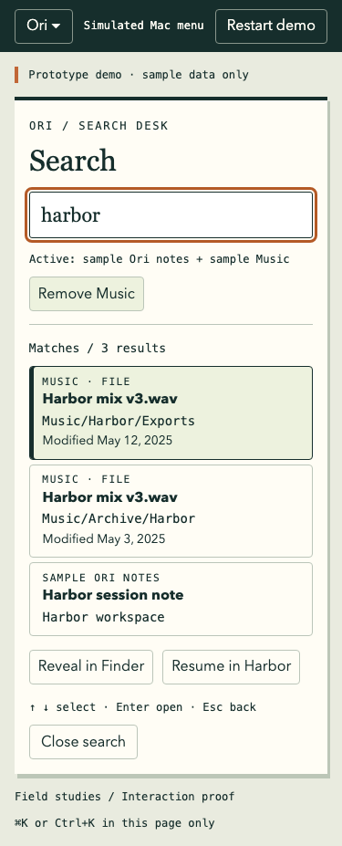
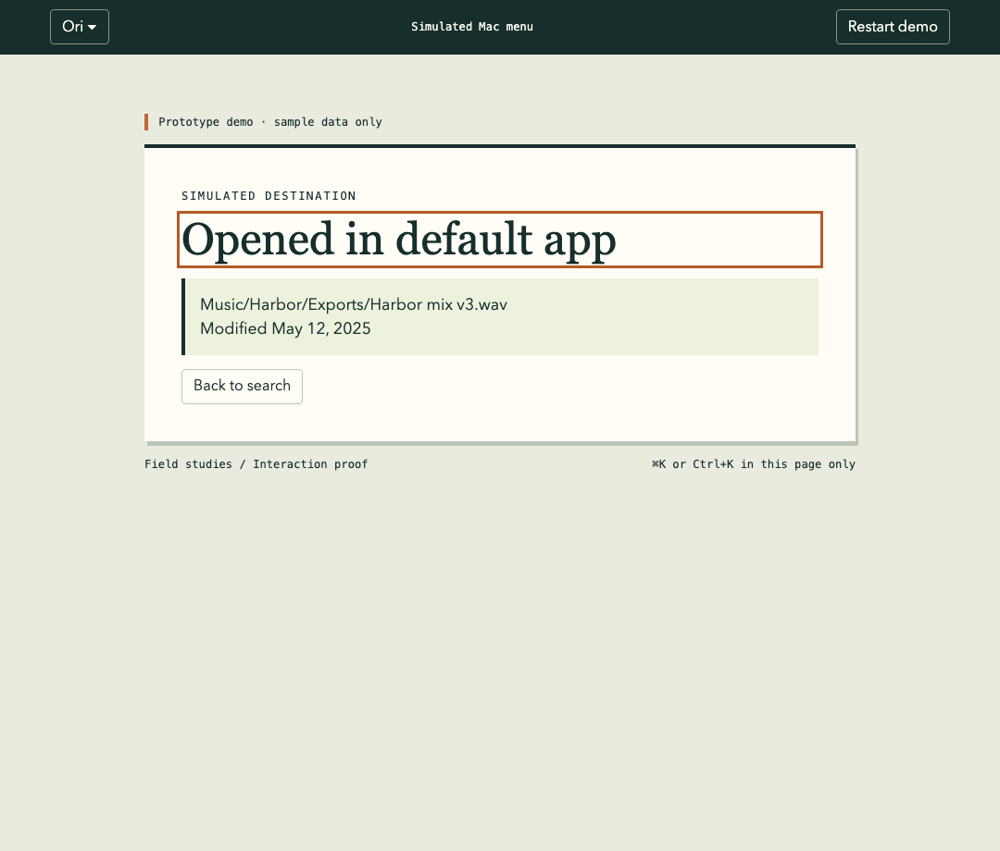

# Ori Search: file first, project second

**Prototype demo · sample data only.** Can someone open the right file without going through an assistant? When they want the project instead, can they find its next step? These stills are from a stand-alone HTML study, not from Finder or a running Ori server. No search feature ships with this evidence.

| Search results at phone width | Default action: open the file |
| --- | --- |
|  |  |

The archive copy has the same name, but not the workspace link. Only the newer file offers **Resume in Harbor**. Opening a file never takes the person to the workspace. The separate note remains searchable even when Music is removed.

| Optional project destination | A miss names the searched sources |
| --- | --- |
|  |  |
