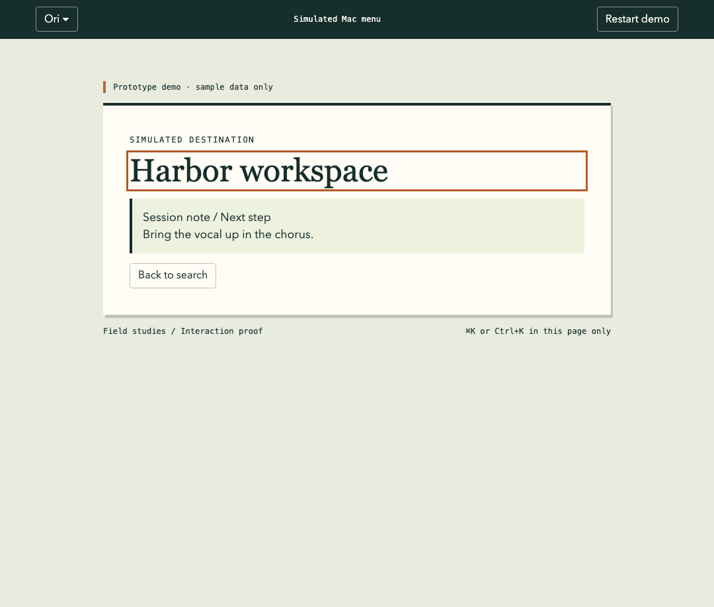
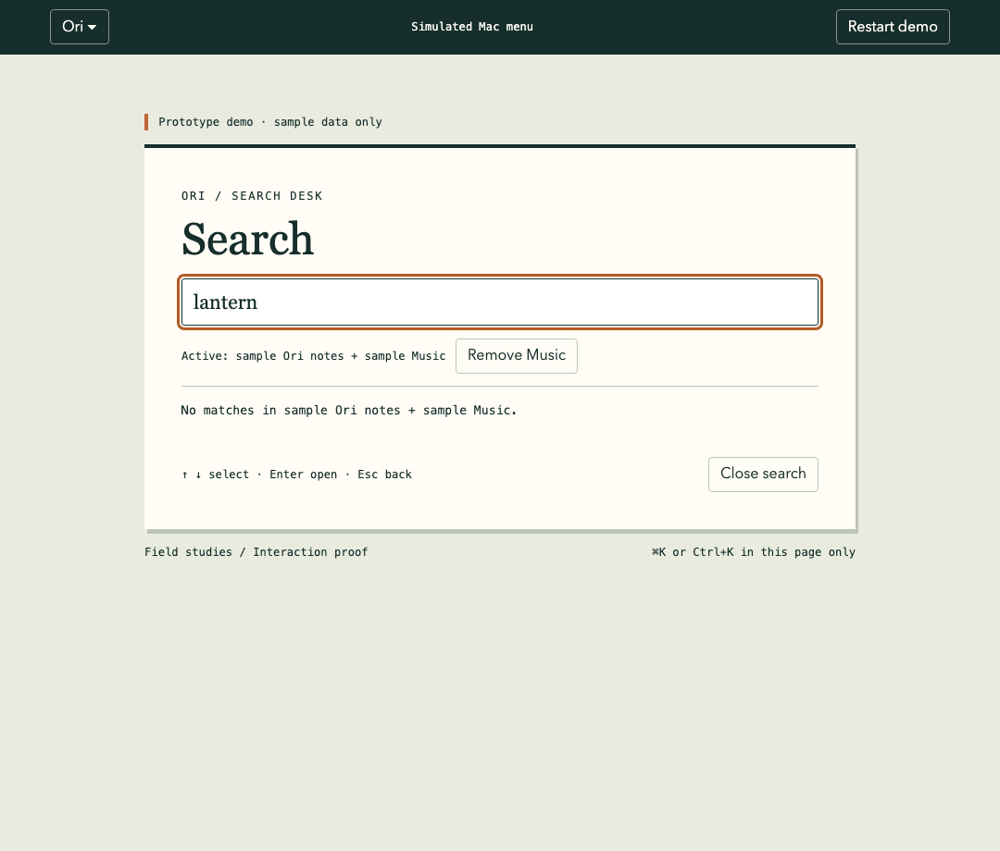

# Ori Search: file first, project second

## Fresh-copy trial

Give the reviewer only the portable HTML file. Keep this page and its stills out of view. Open a fresh copy in a browser (or choose **Restart demo**); sample notes start on, and no file source is selected. Don’t demonstrate the controls. Ask one at a time, without hints:

1. “Open the latest Harbor mix.”
2. “Find where you left off on Harbor.”
3. Afterwards: “Which places did that search?”

**Anonymous observation card** — first file/path: ___ · correct destination on first try: ___ · hints needed: ___ · next step recovered (their words): ___ · places they believed were searched: ___

**Human observations: NOT RUN. Decision: awaiting feedback.** A wrong file points to revising the result rows; unexpected access points to revising the scope copy. If opening works but the next step is hard to recover, revise the secondary action, not the default. If both prompts succeed unaided and the person understands scope, ask whether a real trial is worthwhile. Record *revise*, *stop*, or *consider real trial* with the reason. Clicks alone do not authorize implementation.

## Facilitator reference

Offline Chromium self-checks at 1080px and 375px covered both destinations, keyboard and pointer entry, and scope changes. They do not measure latency, native invocation, real file access or grant revocation, repeat use, or preference over Finder.

**Prototype demo · sample data only.** Can someone open the right file without going through an assistant? When they want the project instead, can they find its next step? These stills are from a stand-alone HTML study, not from Finder or a running Ori server. No search feature ships with this evidence.

| Search results at phone width | Default action: open the file |
| --- | --- |
|  |  |

The archive copy has the same name, but not the workspace link. Only the newer file offers **Resume in Harbor**. Opening a file never takes the person to the workspace. The separate note remains searchable even when Music is removed.

| Optional project destination | A miss names the searched sources |
| --- | --- |
|  |  |
