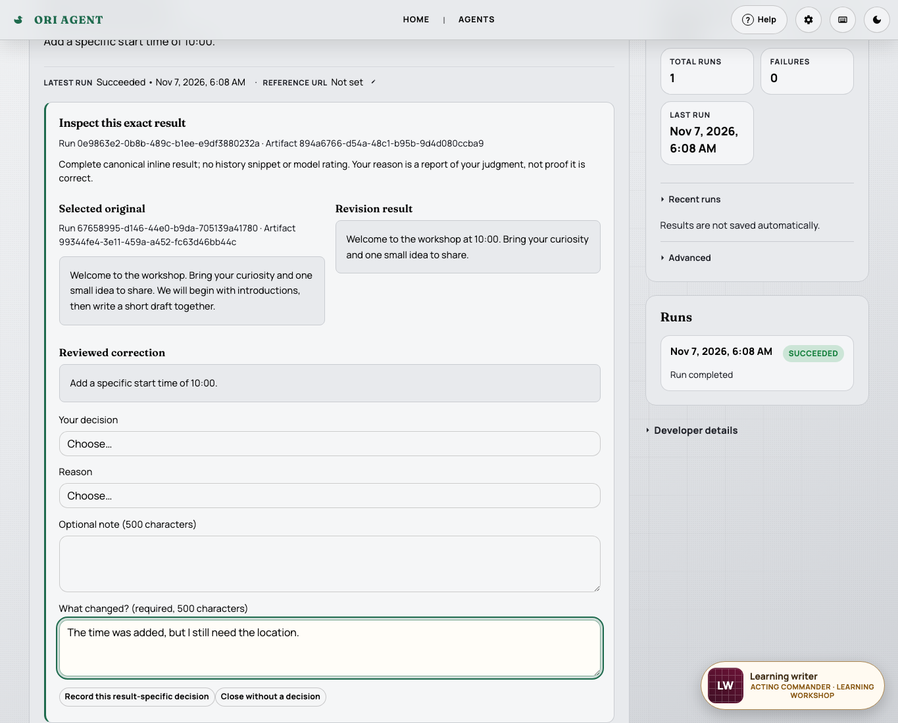
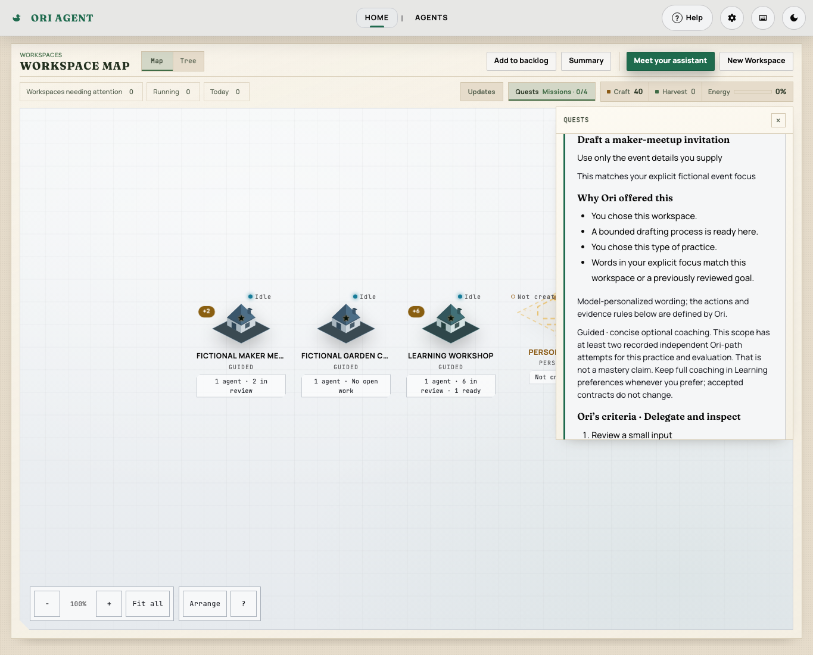
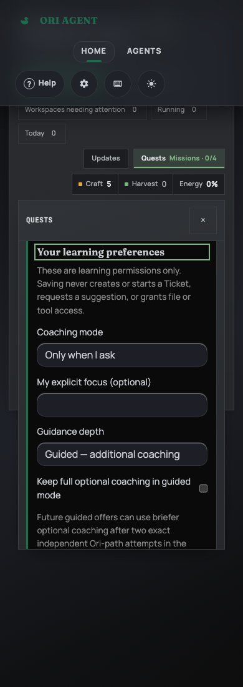

# Adaptive learning missions — review evidence

## Delivery status

**Draft for review, not release-ready.** The user requested opening the PR after
Anthropic rejected the first approved live-quality request. This does not waive
technical pre-push checks or turn the model-quality gate into a pass.

- Requested real model: Claude API `claude-sonnet-5-5`.
- First synthetic case: HTTP 400 `invalid_request_error`; no proposal or usage
  returned. The exact rejection cause is unverified.
- One request, no retry/fallback; a conservative $0.045792 reservation remains
  within the approved $1 / at-most-10-call ceiling. Actual charges are unknown.
- Relevance, achievable action, guidance, unnecessary work, safety and clarity
  are **NOT ASSESSED**. The remaining live cases are **NOT RUN**.
- [Sanitized attempt report](adaptive-learning-missions/live-quality-attempt.json).
- No further paid request is authorized by these reproduction instructions.

The implementation is host-only. No plugin/SDK/protocol/pin/release, installed
account, native credential discovery or personal workspace change is included.
Learning never gates ordinary Tickets, executes merely from acceptance, awards
extra Craft or claims mastery. Stopping/clearing tracking does not cancel work.

## Recorded controlled checks

These are overlapping checkpoints, **not** an additive full-project count:

| Check                                          | Observed checkpoint                                         |
| ---------------------------------------------- | ----------------------------------------------------------- |
| Learning and HTTP race suites                  | 223 passing test/subtest events                             |
| Seven affected Go race packages                | 3933 passing events                                         |
| Scoped server learning/reset/continuity/recipe | 125 passing events                                          |
| Frontend modules/regressions/helper            | 271 Node tests pass                                         |
| Full production controlled tour                | 9 Chromium journeys; 14 scripted provider calls             |
| Layout/keyboard/scoped axe 4.10.3              | 18 cases across Chromium, Firefox and WebKit                |
| Existing settings-reset Chromium suite         | 3 journeys pass                                             |
| Live-quality helper foundation                 | 11 passing events; fake transport/model-free baselines only |
| New owner security scan                        | Pinned gosec 2.29.0: zero findings                          |

Full committed-branch CI is a separate mandatory pre-push gate. Consult the PR
for its final result; the historical checkpoints above do not substitute for it.
No 7/28-day retention, outside-help absence, comprehension, native VoiceOver
listening or whole-site accessibility certification is claimed.

## Selected screenshots

All screenshots below use explicitly **scripted provider replies**, not live
Claude output. They demonstrate application wiring and presentation only.

### Exact original/revision comparison



### Scoped prior practice reduces optional hints, not criteria

The profile and its practice records are controlled fictional fixtures.



### Narrow dark-theme preferences



## Safe reproduction

Run from this feature worktree. The checked-in helper builds the production
server, creates owned disposable HOME/data and uses a loopback scripted provider.
Never point these destructive fixture journeys at an existing server, personal
workspace or installed configuration.

```sh
./scripts/run-test-command.sh node scripts/learning-missions-demo.mjs --final
./scripts/run-test-command.sh node scripts/learning-missions-demo.mjs --group=5
```

For interactive inspection, use `PWDEBUG=1` with the helper. It owns the browser
and server. The lifecycle controller is fixture-only, token-protected and absent
from Ori's routes. The normal app needs no extra account or integration setup.

### Manual journey

1. Open **Missions** and expand **Learning** below finite Getting Started.
   Ordinary Tickets must remain usable without enrolling.
2. Request a generic practice offer in the fixture workspace. Reads, refresh and
   generic proposals must make no design call. Review its goal and fixed criteria.
3. Choose **Start learning**. It accepts tracking only; it must not execute work.
   Prepare/open the Ready Ticket, then separately review exact input/executor
   and explicitly Start that Ticket.
4. Inspect its exact result and choose Use, Revise or Reject with a reason.
   Execution, Done or merely opening the result must not complete practice.
   Rejection can record evaluation; it is not a model quality rating.
5. Exercise improvement: inspect the pinned original, supply a correction, review
   and Start a distinct revision, then record a comparison. Later unrelated Runs
   must not replace either result.
6. Exercise reuse: choose a useful reviewed supplied-text process, provide
   materially different input, separately Start and review a distinct result.
   Unchanged retries must not earn repeat-success credit.
7. Try smaller/alternative previews, defer/decline, full-coaching override and
   read-only earned-evidence inspection. Replacement needs renewed acceptance;
   inspection must not create a nonce, credit or model call.
8. Enable fixture-only automatic suggestions with explicit model/scope consent.
   A fresh distinct recorded review may trigger one bounded offer. Visits,
   polling and restart must not trigger generation or replay old events.
9. Stop or switch Off during held design output; clear learning history
   separately from preferences. No late response may resurrect tracking, and
   actual Tickets/Runs must remain intact.
10. Reset Getting Started and verify learning remains separate. Delete a
    supporting workspace: earned facts remain, but unavailable evidence must
    disclose the loss rather than reconstructing content.

Also verify stale revisions/disclosures, unsupported model isolation, hostile
literal text, deleted/foreign results, imported Start markers, lost network
responses and keyboard/focus restoration fail safely. Both modern and legacy
imports must require fresh destination execution review and carry no learning
authority. App-record reset uses the existing fence/drain/restart lifecycle.

The real-model quality exercise is deliberately opt-in in
`internal/server/learning_missions_live_quality_test.go`; normal tests skip it.
Its recorded failed attempt must not be replayed to bypass the no-retry limit.
