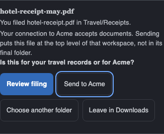
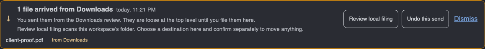

# Verify the Downloads Manager’s destination review

For the repeatable Chromium journey, run from this branch with a free port:

```sh
ORI_DEMO_SPLIT_PROFILE=1 ./scripts/e2e-fresh.sh --port 18561 \
  --sandbox-env ORI_DOWNLOADS_SANDBOX tests/downloads-manager-routing.spec.ts -- --workers=1
```

This uses real Filing APIs and checks the files on disk. No model credentials are needed. For an interactive run, start `ORI_DEMO_SPLIT_PROFILE=1 ./scripts/demo-server.sh 8957 "$(mktemp -d)"`. Use only the printed sandbox’s `home` folder, **not** your real Downloads. Use settled synthetic files (backdate their modification time).

1. Create `home/Downloads/hotel-receipt.pdf`, `home/Travel/Receipts/`, and `home/Acme/`. In personal HQ, hire a folder manager for Downloads. In its workspace open **Details → Open in chat → Review where downloads belong**. Opening this link must not install Filing, grant access, scan or move anything. If needed, explicitly select **Install Filing**, **Allow access to Downloads**, then **Scan now**.
2. Beside `hotel-receipt.pdf`, choose a folder and enter the sandbox Receipts path. **Preview folder** shows just that file; **File** moves it. In its receipt select **Suggest this folder for similar files**. Without this opt-in, there is no remembered destination.
3. Set up manual Filing in a separate Acme workspace for `home/Acme`. In Downloads **Filing → Settings → Connect a workspace**, enable sending Documents to Acme. Do not attach Receipts or any receiver subfolder.
4. Add `hotel-receipt-may.pdf`, `client-proof.pdf`, and `unclear.pdf` to Downloads. Scan; choose **Show the newer scan** if the previous review is pinned. On the repeat receipt, check the original filename, folder and distinguishing question. **Review filing → File** moves only the repeat receipt to Receipts. On the proof, **Send to Acme → Confirm send** moves only the proof to Acme’s top level. Select **Leave in Downloads** for the unclear PDF. Verify all three locations.
5. In **Acme → Filing → Review**, the arrival names the proof and Downloads. **Review local filing** scans the receiving folder. The proof stays at the top level until a separate filing confirmation. An agent is optional; the arrival is not evidence that an agent reviewed it.
6. Use **Undo this send** before filing the proof again. In Downloads **Filing → History**, use **Undo move** on the repeat receipt’s filing. Both files should be back in Downloads; the original example filing is unchanged.
7. Add a fresh proof, scan, and open its send preview. In Acme’s Filing settings turn off the connection, then return and press **Confirm send**. Expect a refusal, the proof still in Downloads, no alternative move, and no successful send receipt. With neither a connection nor a matching example, the chooser and leave action remain available.





This review does not search the computer, browse the receiver, grant content access, or file automatically. Ordinary Filing still has its own batch review; its File button is not used for a Downloads handoff.
